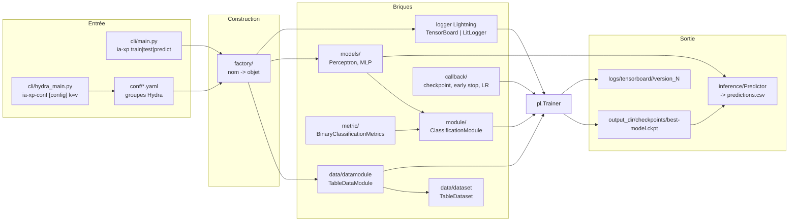
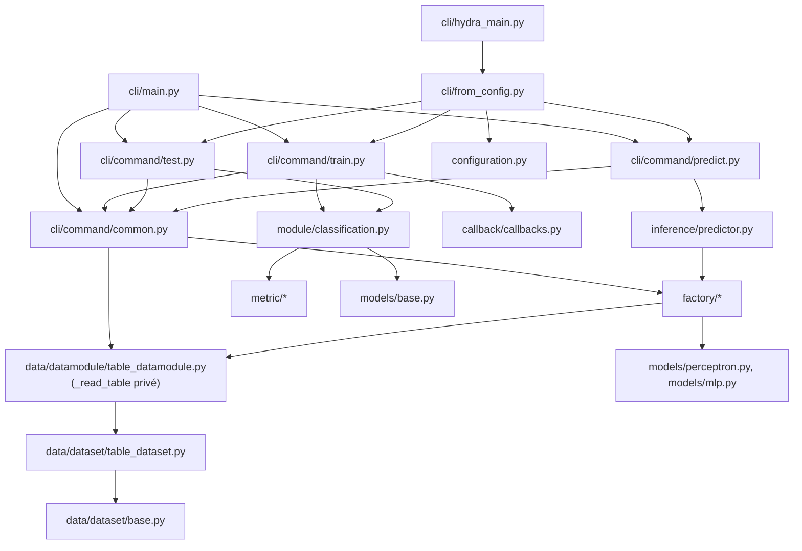

# Phase A — Audit initial de `ia-xp-plateform`

Date : 16 novembre 2026. Dépôt au commit `052992f` plus modifications
locales non commitées. Version du paquet : `0.1.0`.

Ce document décrit l'application telle qu'elle est, pas telle qu'elle
devrait être. Chaque affirmation renvoie à un fichier du dépôt. La
dernière section rassemble ce qu'un assistant IA doit savoir avant de
toucher au code.

Sommaire :

1. [Architecture](#1-architecture)
2. [Fonctionnalités métier](#2-fonctionnalités-métier)
3. [Cartographie des dépendances](#3-cartographie-des-dépendances)
4. [Risques techniques](#4-risques-techniques)
5. [Contexte de référence pour l'IA](#5-contexte-de-référence-pour-lia)

---

## 1. Architecture

### 1.1 Vue d'ensemble

`ia-xp-plateform` est une plateforme pédagogique de classification
binaire sur données tabulaires, construite sur PyTorch Lightning. Elle
sépare strictement cinq rôles : lire les données, calculer une sortie,
entraîner, mesurer, prédire. Deux entrées en ligne de commande
l'exposent : `ia-xp` (argparse) et `ia-xp-conf` (Hydra).

Taille du code : 2 229 lignes Python dans `ia_xp_plateform/`, 2 038
lignes de tests dans `test/`, 11 fichiers YAML dans `conf/`.



### 1.2 Couches et responsabilités

| Couche | Fichiers | Rôle | Ne fait pas |
| --- | --- | --- | --- |
| Données | `data/dataset/base.py`, `data/dataset/table_dataset.py`, `data/datamodule/table_datamodule.py` | Lire un fichier CSV/Feather/HDF5, exiger un `id` unique, découper train/val/test, exposer `(x, y)` en float32 | Nettoyage, normalisation, encodage |
| Modèles | `models/base.py`, `models/perceptron.py`, `models/mlp.py` | `forward(x) -> probabilité` ; contrat `BaseModel(nn.Module, ABC)` | Perte, optimiseur, métriques |
| Tâche | `module/classification.py` | `BCELoss`, Adam, appel des métriques, `self.log`, image de la matrice de confusion | Lecture de fichiers, choix du modèle |
| Métriques | `metric/binary_classification.py`, `metric/confusion_matrix.py` | Compteurs d'époque (TP/FP/FN/total), justesse, précision, rappel, F1, matrice 2×2 brute et normalisée, figure matplotlib | Décision du seuil (il est passé par le module) |
| Observateurs | `callback/callbacks.py` | `ModelCheckpoint` (val_loss, top 1, `best-model`), `EarlyStopping`, `LearningRateMonitor` | Calcul de métriques |
| Factories | `factory/model_factory.py`, `factory/datamodule_factory.py`, `factory/logger_factory.py` | Registres `nom -> classe` : `perceptron`, `mlp`, `table`, `tensorboard`, `litlogger` | Instanciation Hydra (`_target_` absent par choix) |
| Inférence | `inference/predictor.py` | Charger un `.ckpt` sans Trainer, retirer le préfixe `model.`, `predict_proba` / `predict` | Lecture de tables (fait par le CLI) |
| CLI | `cli/main.py`, `cli/command/*.py`, `cli/hydra_main.py`, `cli/from_config.py`, `configuration.py` | Argparse et Hydra convergent vers un `SimpleNamespace` plat consommé par `run_train` / `run_test` / `run_predict` | Logique métier |

### 1.3 Flux d'exécution

**train** (`cli/command/train.py`)
1. `build_datamodule` → `TableDataModule.setup()` lit le fichier, découpe, déduit les colonnes attributs du jeu train.
2. `build_model` vérifie `input_features` contre le nombre de colonnes, puis `create_model(name, **kwargs)`.
3. `ClassificationModule(model, learning_rate, threshold)`.
4. `create_callbacks(CallbackConfig(output_dir, patience))`.
5. `make_trainer` construit le logger via `build_logger` puis `pl.Trainer(callbacks=..., logger=...)`.
6. `trainer.fit`, puis impression de `best_model_path`.

**test** : même construction, `Trainer(logger=False)`, `trainer.test(ckpt_path=...)`. Échec explicite si `test_dataset is None`.

**predict** : lit la table, choisit les colonnes (toutes sauf `id` et, si donnée, la cible), `Predictor.from_checkpoint`, une passe `predict_proba`, seuil, CSV `id, probability, prediction` (ou `probability_i`, `prediction_i` si plusieurs sorties).

**ia-xp-conf** : `parse_launch_arguments` sépare un éventuel nom de fichier `conf/<nom>.yaml` (premier argument sans `=`) des surcharges `groupe.clef=valeur`. `load_config` compose avec `initialize_config_dir` + `compose` (version_base 1.3, sans `@hydra.main`, donc pas de `chdir` ni de dossier `.hydra`). `namespace_from_config` aplatit les groupes.

### 1.4 Configuration Hydra (`conf/`)

```text
conf/
├── config.yaml              # défaut : data=perceptron model=perceptron ... + override model.input_features: 16
├── train_perceptron.yaml    # input_features: null, output_dir logs/train_perceptron
├── train_mlp.yaml           # model=mlp, input_features 16, hidden 16×10, output_dir logs/train_mlp, logger name mlp
├── data/perceptron.yaml     # chemin absolu vers bank-full-ordinal.feather, target y, batch 32
├── model/perceptron.yaml    # input_features: 15 (écrasé par config.yaml), output 1
├── model/mlp.yaml           # input null, output 1, hidden_features 16, hidden_layers 1
├── trainer/default.yaml     # accelerator gpu, max_epochs 200, progress bar et résumé activés
├── module/classification.yaml   # lr 0.01, threshold 0.5
├── callbacks/default.yaml       # early_stopping_patience 5
└── logger/{tensorboard,litlogger}.yaml
```

Les objets ne sont jamais construits par Hydra. La configuration donne
des noms ; les factories construisent.

### 1.5 Journalisation et artefacts

- Métriques scalaires par époque : `{train,val,test}_{loss,acc,precision,recall,f1}` et `lr-Adam`.
- Images par époque (TensorBoard uniquement, via `experiment.add_figure`) : `{stage}_confusion_matrix` et `{stage}_confusion_matrix_normalized`.
- Checkpoint : `output_dir/checkpoints/best-model.ckpt`, versionné `best-model-vN.ckpt` si le dossier n'est pas vide.
- Courbes : `logs/tensorboard/<logger.params.name>/version_N`. Le dossier `logs/` est ignoré par Git.

### 1.6 Tests

134 tests collectés (`poetry run pytest`). Deux répertoires :

- `test/unitaire/` (15 fichiers) : chaque brique isolée, cas d'erreur inclus.
- `test/integration/` (10 fichiers) : fichiers réels dans `tmp_path`, `Trainer.fit` complet, parcours train → test → predict par `ia-xp` et par `ia-xp-conf`, lecture des événements TensorBoard.

Une fixture autouse (`test/integration/conftest.py`) remplace `litlogger.Experiment` par une version hors ligne pour que la suite ne tente pas d'ouvrir un navigateur.

**État au moment de l'audit : 132 réussis, 2 échecs** dans `test/unitaire/test_configuration.py`. Les deux assertions comparent des valeurs d'expérience modifiées à la main depuis (`model.input_features` passé de 1 à 16, `hidden_layers` de 1 à 10 dans `train_mlp.yaml`). Voir risque R1.

---

## 2. Fonctionnalités métier

| Id | Fonctionnalité | Où | État |
| --- | --- | --- | --- |
| F1 | Charger un jeu tabulaire depuis un seul fichier CSV, Feather ou HDF5 (`hdf_key`) | `_read_table` | Fait, testé 3 formats |
| F2 | Identifier chaque ligne par une colonne `id` unique, exclue des entrées | `_require_unique_id`, `TableDataModule.setup` | Fait, erreurs explicites |
| F3 | Découper train/val/test automatiquement (`val_split`, `test_split`, `split_seed`) | `_split_dataframe` | Fait |
| F4 | Découper selon un fichier compagnon `split` joint par `id`, ordre libre | `_split_from_file` | Fait, chaque cas d'erreur testé |
| F5 | Choisir les colonnes d'entrée (toutes sauf id/cible, ou liste explicite) | `TableDataModule`, `feature_columns_of` | Fait |
| F6 | Perceptron : une couche linéaire + sigmoïde | `models/perceptron.py` | Fait |
| F7 | MLP : `hidden_layers` couches cachées de largeur `hidden_features`, ReLU, sigmoïde, `output_features` sorties | `models/mlp.py` | Fait |
| F8 | Entraîner une classification binaire (BCE, Adam, seuil) | `module/classification.py` | Fait |
| F9 | Mesurer justesse, précision, rappel, F1 sur l'époque entière | `metric/binary_classification.py` | Fait |
| F10 | Visualiser la matrice de confusion (effectifs et normalisée) par époque dans TensorBoard | `metric/confusion_matrix.py`, `_log_confusion_matrix` | Fait |
| F11 | Garder le meilleur modèle, arrêter tôt, suivre le taux d'apprentissage | `callback/callbacks.py` | Fait |
| F12 | Suivre l'expérience dans TensorBoard (défaut) ou LitLogger | `factory/logger_factory.py`, `conf/logger/` | Fait ; ClearML documenté comme futur |
| F13 | Évaluer un checkpoint sur le jeu de test | `cli/command/test.py` | Fait |
| F14 | Prédire sur un nouveau fichier et écrire un CSV | `cli/command/predict.py`, `Predictor` | Fait |
| F15 | Lancer par options (`ia-xp`) ou par fichiers de configuration nommés et surcharges (`ia-xp-conf train_mlp k=v`) | `cli/` | Fait |
| F16 | Comparer les expériences passées et courantes | `version_N` TensorBoard | Fait |

Hors périmètre aujourd'hui : classification multi-classes (softmax),
régression, validation croisée, prétraitement des données (échelle,
valeurs manquantes, catégories), export du modèle hors `.ckpt`,
métriques indépendantes du seuil (AUC-ROC, average precision).

Jeu de données de référence actuel (`conf/data/perceptron.yaml`) :
`bank-full-ordinal.feather`, 45 211 lignes, 16 attributs entiers,
cible `y` avec 11,7 % de positifs (5 289 / 45 211).

---

## 3. Cartographie des dépendances

### 3.1 Outillage

| Élément | Valeur |
| --- | --- |
| Python | 3.12.3 (`requires-python >= 3.12`) |
| Gestionnaire | Poetry 2, PEP 621, venv dans le dépôt (`poetry.toml`) |
| Build | `poetry-core >= 2.0` |
| Tests | pytest 9.2 (`[tool.poetry.group.dev.dependencies]`) ; `testpaths` non déclaré dans `pyproject.toml`, pytest découvre `test/` par défaut |
| Scripts | `ia-xp`, `ia-xp-conf` |
| CI, lint, typage | absents |
| `Makefile` | vide |

### 3.2 Dépendances d'exécution

| Paquet | Contrainte | Installé | Usage dans le code | Remplaçable ? |
| --- | --- | --- | --- | --- |
| `torch` | `>=2.15,<3` | 2.15.0+cu132 | tenseurs, `nn.Linear`, `BCELoss`, Adam, `torch.load(weights_only=True)` | Non, cœur |
| `pytorch-lightning` | `>=2.6.6,<3` | 2.6.6 | `LightningModule`, `LightningDataModule`, `Trainer`, callbacks, loggers | Non, cœur. Importé comme `pytorch_lightning`, pas `lightning` |
| `pandas` | `>=3.1,<4` | 3.1.0 | lecture CSV/Feather/HDF5, jointure split, écriture CSV | Non |
| `pyarrow` | `>=26,<27` | 26.0.1 | lecture Feather | Oui si Feather abandonné |
| `tables` | `>=3.11,<4` | 3.11.1 | lecture HDF5 | Oui si HDF5 abandonné |
| `hydra-core` | `>=1.3.2,<1.4` | 1.3.8 (omegaconf 2.3.1) | composition de `conf/`, surcharges | Oui, isolé dans `configuration.py` et `from_config.py` |
| `tensorboard` | `>=2.20,<3` | 2.21.0 | `TensorBoardLogger`, `add_figure`, lecture d'événements dans les tests | Oui via la factory |
| `litlogger` | `>=0.1.0` | 2026.8.28 | `LitLogger` (lightning.ai) | Oui via la factory |
| `matplotlib` | `>=3.11.2,<4` | 3.11.2 | figure de la matrice de confusion (`Figure` + `FigureCanvasAgg`, sans backend global) | Oui, isolé dans `metric/confusion_matrix.py` |

Transitives notables : `lightning-sdk` (tirée par `litlogger`) affiche un
avertissement de version à chaque import et tente une authentification
navigateur dès qu'un `Experiment` réel est construit.

### 3.3 Graphe interne (qui importe qui)



Aucun cycle. Les briques (`data`, `models`, `metric`, `callback`) ne
dépendent pas du CLI ni de Hydra. Un point de couplage : `cli/command/common.py`
importe la fonction privée `_read_table` du datamodule.

### 3.4 Dépendances externes au dépôt

- Fichier de données hors dépôt, chemin absolu dans `conf/data/perceptron.yaml` (`.../IA_DATA_FORMAT_CONVERTER/data/output/bank-full-ordinal.feather`).
- GPU CUDA attendu par `conf/trainer/default.yaml` (`accelerator: gpu`).
- Compte lightning.ai si `logger=litlogger`.

---

## 4. Risques techniques

Gravité : **H** bloque ou fausse un résultat ; **M** gêne ou fragilise ;
**B** confort ou dette.

| Id | Gravité | Risque | Preuve | Piste |
| --- | --- | --- | --- | --- |
| R1 | H | Les tests de configuration figent des valeurs d'expérience que l'utilisateur modifie à la main (`input_features`, `max_epochs`, `hidden_layers`, `accelerator`). La suite casse à chaque réglage. | 2 échecs actuels dans `test_configuration.py` ; déjà corrigé trois fois pendant le développement | Tester la structure (clés présentes, types, interpolation `${seed}`) plutôt que les valeurs ; ou séparer une config de test de la config d'expérience |
| R2 | H | Aucune normalisation des entrées. Le jeu actuel mélange `balance` (−8 019 à 102 127), `duration` (0 à 4 918) et des indicateurs 0/1. Un perceptron ou un MLP avec sigmoïde + `BCELoss` sature et apprend mal. | `describe()` du feather ; `TableDataset` convertit tel quel | Étape de prétraitement (standardisation ajustée sur train) dans le datamodule, ou exiger un fichier déjà normalisé et le vérifier |
| R3 | H | Déséquilibre 88/12 non traité. Le modèle répond toujours 0 : justesse 0,883 constante, précision/rappel/F1 à 0 sur toutes les époques. Les métriques ne distinguent pas deux modèles. | Événements TensorBoard `version_0/1` lus pendant la session | Pondération de la perte (`pos_weight`), rééchantillonnage, métriques indépendantes du seuil (average precision, AUC) |
| R4 | M | `BCELoss` après `sigmoid` plutôt que `BCEWithLogitsLoss` sur les logits : moins stable numériquement (log(0)). Les modèles renvoient déjà une probabilité, donc changer la perte change le contrat `BaseModel`. | `module/classification.py`, `models/*.py` | Décision d'architecture à prendre avant d'ajouter des modèles |
| R5 | M | Reproductibilité partielle : seule la permutation du split est semée (`torch.Generator().manual_seed`). L'initialisation des poids et l'ordre des batches ne le sont pas (`seed_everything` absent). | grep `seed_everything` : aucun résultat | Appeler `pl.seed_everything(cfg.seed)` dans `run_train` |
| R6 | M | `accelerator: gpu` en défaut Hydra : `ia-xp-conf` échoue sur une machine sans CUDA. Les tests d'intégration doivent surcharger `trainer.accelerator=cpu`. Le commentaire du fichier dit encore « reste cpu ». | `conf/trainer/default.yaml` | `auto` en défaut, commentaire à jour |
| R7 | M | Incohérences de configuration : `model/perceptron.yaml` dit 15 entrées, `config.yaml` écrase à 16, `train_mlp.yaml` fixe 16 en dur. Un changement de fichier de données casse silencieusement l'un ou l'autre. | fichiers cités | `input_features: null` partout (déduction automatique déjà supportée) |
| R8 | M | `litlogger` ouvre un navigateur et bloque le processus dès la construction d'un `Experiment`. Protégé dans les tests par monkeypatch seulement. | `conftest.py`, incident en session | Garder TensorBoard en défaut ; documenter ; envisager un flag offline |
| R9 | M | Compteurs de métriques en `float` Python, non synchronisés entre processus. Faux en multi-GPU/DDP. | `BinaryClassificationMetrics` | Acceptable sur 1 device ; passer à `torchmetrics` ou des buffers si DDP |
| R10 | M | `test` reconstruit un `Trainer` sans les callbacks qui ont écrit le checkpoint : Lightning avertit à chaque `ckpt_path`. Les images de confusion du test ne sont jamais produites (`logger=False`). | `cli/command/test.py`, `make_trainer` | Logger optionnel en test ; ou charger les poids via `Predictor` et calculer les métriques à part |
| R11 | M | Pas de validation croisée ni de dossier de sortie par run : `output_dir` fixe produit `best-model-v1.ckpt`, `-v2`, … et l'avertissement « checkpoint directory not empty ». | observé dans `logs/xp01/checkpoints` | Sous-dossier daté ou `version_N` côté checkpoint |
| R12 | B | Couplage du CLI à une fonction privée `_read_table`. | `cli/command/common.py` | La rendre publique dans `data/` |
| R13 | B | Docstring de `Perceptron.forward` parle de « logit avant activation » alors que le code renvoie une sigmoïde. | `models/perceptron.py` | Corriger la docstring |
| R14 | B | Noms de fichiers de test : pytest collecte par nom de base ; deux fichiers homonymes dans `unitaire/` et `integration/` entrent en collision. Convention implicite, non outillée. | historique de session | `__init__.py` dans les dossiers de test, ou `addopts = --import-mode=importlib` |
| R15 | B | Fichiers compilés `__pycache__` étaient suivis par Git malgré `.gitignore` ; retirés de l'index en session, suppression non encore commitée. `checkpoints/` à la racine et `predictions.csv` ne sont pas ignorés. | `git status` | Commiter, compléter `.gitignore` |
| R16 | B | Licence MIT déclarée dans `pyproject.toml` sans fichier `LICENSE`. `Makefile` vide. Pas de CI, lint, typage. | racine du dépôt | Ajouter au fil de l'eau |
| R17 | B | Le CLI `ia-xp` ne propose pas `--hidden-layers` dans `--help` de façon découvrable par modèle ; options MLP visibles même pour `perceptron`. | `add_model_arguments` | Acceptable ; documenter |

---

## 5. Contexte de référence pour l'IA

Ce bloc est prévu pour être copié en tête d'une conversation ou dans
une règle d'agent. Il résume les invariants que le code suppose.

### 5.1 Identité du projet

- Paquet Python `ia_xp_plateform` (dépôt `ia-xp-plateform`), Python 3.12, Poetry, venv dans le dépôt. Projet pédagogique personnel : docstrings et README en français, ton explicatif, langage affirmatif.
- Règle de contribution (`AGENTS.md`) : toute modification s'accompagne d'un test unitaire, d'un test d'intégration et d'une mise à jour du README si le fonctionnement global change.
- Ne pas commiter sans demande explicite. Ne pas reprendre la structure d'anciens projets (`ia_xp_plat_trash`, `xp`) sauf demande.

### 5.2 Invariants d'architecture

- Un dataset expose `(x, y)` en float32, rien d'autre. Le datamodule est le seul à lire des fichiers.
- Un modèle ne fait que `forward`. Il hérite de `BaseModel(nn.Module, ABC)` et renvoie une **probabilité dans (0, 1)** (sigmoïde incluse). La perte est `BCELoss`, le seuil par défaut 0,5.
- `ClassificationModule` porte perte, optimiseur et appels aux métriques. Les métriques vivent dans `metric/`, pas dans `callback/`. Les callbacks observent des valeurs déjà journalisées.
- Les factories sont des dictionnaires `nom -> classe` : `MODELS` (`perceptron`, `mlp`), `DATAMODULES` (`table`), `LOGGERS` (`tensorboard`, `litlogger`). Un nom inconnu lève `ValueError` en listant les noms connus. Ajouter un objet = une ligne dans le registre + un fichier `conf/<groupe>/<nom>.yaml`.
- Hydra compose, les factories construisent. Pas de `_target_`, pas de `hydra.utils.instantiate`, pas de `@hydra.main`.
- `Predictor` charge un `.ckpt` avec `torch.load(..., weights_only=True)`, retire le préfixe `model.`, et n'accepte que des tenseurs. La lecture de tables reste dans le CLI.
- Colonne `id` obligatoire et unique, jamais une entrée. Cible exclue des entrées. Fichier `split` compagnon joint par `id`, ordre indifférent.

### 5.3 Conventions de code et de tests

- Importer Lightning via `pytorch_lightning` (le métapaquet `lightning` n'est pas installé). Callbacks depuis `pytorch_lightning.callbacks`.
- Le dossier s'appelle `factory`, pas `factories`. Les tests sont dans `test/unitaire` et `test/integration`, avec des noms de fichiers uniques entre les deux.
- `create_logger(logger_name, **kwargs)` : le premier paramètre ne s'appelle pas `name` parce que les loggers Lightning reçoivent `name` comme nom d'expérience.
- Les tests d'intégration utilisent la fixture `sample_dataframe` (20 lignes, colonnes `id, a, b, target`) et surchargent `data.target_columns=target model.input_features=2 trainer.accelerator=cpu` parce que la configuration par défaut vise le jeu réel de l'utilisateur.
- Les tests ne doivent rien écrire dans le dépôt : `tmp_path` partout, `enable_checkpointing=False` quand aucun checkpoint n'est attendu.
- Les YAML de `conf/` sont des réglages d'expérience que l'utilisateur modifie librement. Ne pas les réinitialiser. Ne pas écrire de test qui dépend de leurs valeurs numériques.

### 5.4 Commandes utiles

```bash
poetry install
poetry run pytest -q
poetry run ia-xp-conf                        # conf/config.yaml
poetry run ia-xp-conf train_mlp              # conf/train_mlp.yaml
poetry run ia-xp-conf train_perceptron trainer.max_epochs=10 trainer.accelerator=cpu
poetry run ia-xp-conf mode=test checkpoint=logs/xp01/checkpoints/best-model.ckpt
poetry run ia-xp-conf mode=predict checkpoint=... predictions=out.csv
poetry run ia-xp train --data data.csv --target y --output-dir logs/run
poetry run tensorboard --logdir logs/tensorboard
```

### 5.5 Pièges connus

- `ia-xp-conf --help` est traité à part : Hydra rejette `--help` comme surcharge.
- Un deuxième `fit` dans le même `output_dir` écrit `best-model-v1.ckpt`.
- La barre de progression n'affiche que `v_num` : `self.log` n'utilise pas `prog_bar=True`.
- `LearningRateMonitor` exige un logger sur le Trainer ; en `test`, `logger=False` donc pas de callbacks.
- Sur le jeu actuel, précision, rappel et F1 de validation valent 0 : aucune probabilité ne dépasse 0,5 (classe majoritaire à 88 %). Ce n'est pas un bug de métrique.
- Avertissements Lightning attendus et sans effet : `GPU available but not used`, `LeafSpec deprecated`, `num_workers`, `log_every_n_steps`, `ckpt_path` sans callbacks, `LitLogger does not support log_graph`.

### 5.6 Prochaines étapes suggérées (hors audit)

1. Découpler les tests de configuration des valeurs d'expérience (R1).
2. Ajouter un prétraitement des entrées et une stratégie pour le déséquilibre (R2, R3), puis une métrique indépendante du seuil.
3. `seed_everything` et `accelerator: auto` (R5, R6).
4. Décider logits vs probabilités avant d'ajouter d'autres modèles (R4).
